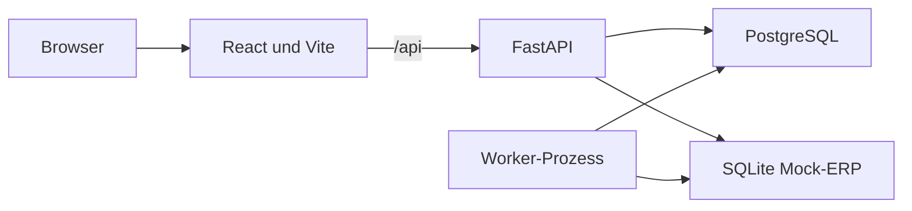

# Architektur

HopLogic BrauPartner ist eine Anwendung mit drei Schichten und einer abgetrennten ERP-Testquelle.

## Frontend

`frontend/` enthält React, TypeScript, Vite, Tailwind CSS und React Router. Der Entwicklungsserver nimmt `/api` entgegen und leitet die Aufrufe an FastAPI weiter. Die Zieladresse steht in `API_PROXY_TARGET` und trägt kein `VITE_`-Präfix, damit sie nicht ins ausgelieferte JavaScript gelangt.

Mutierende Aufrufe senden das CSRF-Token aus dem Cookie `bp_csrf` mit. Sitzung und Token liegen in Cookies. Die Oberfläche zeigt einen Speichervorgang erst nach einer erfolgreichen API-Antwort als abgeschlossen.

Seiten gibt es für Partner, Kontakte, Aktivitäten, Aufgaben, Verkaufschancen, Produkte, Bestellungen, Service, Segmente, Kampagnen, Automatisierungen, Benachrichtigungen, Reporting, Benutzer und die ERP-Integration. Noch nicht umgesetzte Menüpunkte bleiben als geplante Module sichtbar.

## Backend

`backend/app/` trennt HTTP, Fachlogik und Persistenz.

| Pfad | Aufgabe |
| --- | --- |
| `main.py` | Anwendung, CORS, Routen, eingebetteter Worker |
| `config.py` | Einstellungen aus Umgebungsvariablen und `.env` |
| `database.py` | Engine und Sitzungen |
| `access.py` | Berechtigungscodes und Zuordnung von Route zu Recht |
| `authorize.py` | Prüfung von Sitzung und CSRF |
| `security.py` | Passwort-Hash und Cookies |
| `api/` | REST-Routen |
| `schemas/` | Pydantic-Modelle |
| `services/` | Fachlogik und Transaktionen |
| `models/` | SQLAlchemy-Modelle |
| `integrations/` | ERP-Protokoll, Mock-Connector, Abbildung der Daten |
| `worker.py` | Zeitgesteuerte Automatisierungen und ERP-Läufe |

`GET /api/health` prüft den API-Prozess. `GET /api/health/db` führt `SELECT 1` aus. Bei einem Datenbankfehler antwortet die API mit Status 503 und ohne Verbindungsdetails.

Unbekannte `/api`-Pfade sind standardmässig gesperrt. SQLAlchemy verwendet gebundene Parameter. React setzt Texte als Textknoten, nicht als HTML.

## Datenbank

PostgreSQL 16 hält die CRM-Daten. Alembic führt die Migrationen `0001_initial` bis `0008_integration` in einer Kette. `alembic heads` zeigt genau `0008_integration`.

Fremdschlüssel verbinden Kontakte, Aktivitäten, Aufgaben, Deals, Bestellungen, Tickets, Kampagnen und ERP-Protokolle mit den Partnern. Bestellpositionen speichern Preis, Menge und Steuer zum Zeitpunkt der Bestellung. Eine spätere Katalogänderung schreibt diese Positionen nicht um.

Ein Neustart der API löscht keine gespeicherten Zeilen. Docker Compose legt die Datenbank in das Volume `postgres_data`.

## Hintergrundprozesse

`app.worker` prüft fällige Automatisierungen und, wenn der Modus Mock-ERP ist und ein Intervall grösser als 0 ist, die entsprechenden Synchronisationen. Automatische Bestellübertragungen bleiben aus.

Lokal kann der Worker im API-Prozess mitlaufen, solange `AUTOMATION_EMBEDDED_WORKER` wahr ist und kein pytest-Lauf aktiv ist. Im Container übernimmt der Dienst `worker`, und der API-Prozess schaltet den eingebetteten Worker aus.

## ERP-Integrationsschicht

Die CRM-Module kennen keinen ERP-Hersteller. Sie rufen den Synchronisationsdienst auf. Dieser spricht nur das Connector-Protokoll.

Registriert ist allein der Mock-Connector. Er liest und schreibt die SQLite-Datei `data/mock-erp.sqlite`. Diese Datei ist nicht die CRM-Datenbank. Alle Zeilen sind fiktive Testdaten.

Ein externer Connector ist nicht registriert und öffnet keine Verbindung. Der Modus «Externes ERP» bleibt gesperrt, bis eine Connector-Klasse registriert ist und `ERP_BASE_URL` mit `https://` sowie Client-ID und Secret ausserhalb des Quellcodes gesetzt sind. Eine spätere Klasse muss TLS, ein Zeitlimit und eine begrenzte Zahl von Wiederholungen verwenden.

Führend ist die externe Quelle für ERP-Kundennummer, ERP-Kundenstatus, Artikelnummer und den aktuellen Katalogpreis. Führend ist das CRM für Notizen, Aktivitäten, Aufgaben, Segmente, Betreuung und den CRM-Partnerstatus. Abweichende, bereits gefüllte Stammdaten werden nicht überschrieben. Sie erscheinen als Konflikt.

Der CRM-Bestellstatus und der technische Übertragungsstatus sind getrennte Felder. Eine erfolgreiche Übertragung ist keine Lieferung und keine Rechnung. Der Übertragungsschlüssel ist `crm-{Bestell-ID}`. Eine unklare Antwort wird nicht erneut gesendet, sondern zur manuellen Prüfung markiert. Neue Mock-Referenzen enthalten ein Kennzeichen der Testdatei, damit ein neues Mock-ERP keine bereits gespeicherte Referenz wiederverwendet.
