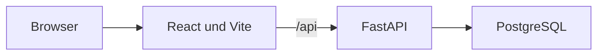

# Architektur

HopLogic BrauPartner ist in dieser Phase eine schlanke Dreischicht-Anwendung.

## Frontend

`frontend/` enthält die Oberfläche mit React, TypeScript und Vite. Tailwind CSS gestaltet die Statusseite. Der Vite-Entwicklungsserver nimmt Aufrufe unter `/api` entgegen und leitet sie an FastAPI weiter. Im Container ist das Ziel `http://backend:8000`, lokal `http://localhost:8000`.

Die Zieladresse liest Vite aus `API_PROXY_TARGET`. Diese Variable trägt kein `VITE_`-Präfix und gelangt dadurch nicht in das JavaScript der Oberfläche.

## Backend

`backend/app/` ist nach Verantwortungen getrennt:

| Pfad | Aufgabe |
| --- | --- |
| `main.py` | Anwendung, CORS und Routen |
| `config.py` | Einstellungen aus Umgebungsvariablen und `.env` |
| `database.py` | Engine, Sitzungen und Prüfabfrage |
| `api/` | HTTP-Routen |
| `schemas/` | Pydantic-Modelle der Antworten |
| `models/` | SQLAlchemy-Modelle der späteren Fachmodule |

`GET /api/health` prüft den API-Prozess. `GET /api/health/db` führt `SELECT 1` aus. Schlägt die Datenbank fehl, antwortet die API mit Status 503 und der Meldung «Datenbank nicht erreichbar». Verbindungsdetails bleiben in der Antwort aus.

## Datenbank

PostgreSQL 16 läuft als Dienst `db` in Docker Compose. SQLAlchemy spricht über den Treiber `psycopg` mit der Datenbank. Alembic verwaltet das Schema. Die erste Migration legt bewusst noch keine Fachtabellen an und erzeugt beim Anwenden nur die Alembic-Versionstabelle.

Neue Modelle kommen nach `backend/app/models/` und werden in `backend/app/models/__init__.py` importiert, damit Alembic sie erkennt.

## Container

`docker-compose.yml` startet Datenbank, API und Oberfläche. Die API wartet auf PostgreSQL, führt `alembic upgrade head` aus und startet danach Uvicorn. Der Container gilt erst als bereit, wenn `/api/health/db` erfolgreich antwortet. Die Oberfläche startet nach diesem Zeitpunkt.

## Was diese Phase auslässt

Authentifizierung, Kontakte, Brauerei-Prozesse und weitere CRM-Fachlichkeit folgen später an den genannten Stellen, ohne den Grundaufbau zu wechseln.
